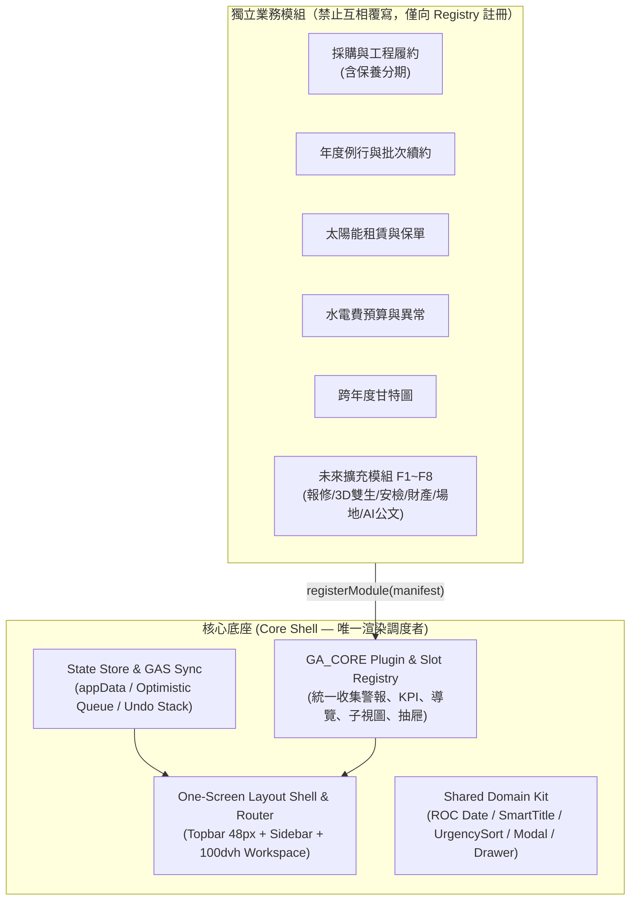

# 總務行政戰情助理 — 網頁頁面與前端架構設計規則規範書（AI 架構師與開發代理遵循憲章）

> **文件編號**：`UI_DESIGN_RULES.md`（v2.0 Architecture & UX Constitution）  
> **適用對象**：所有參與本專案開發、重構、擴充模組與介面調整之架構 AI 與工程代理（Architecture AI / Coding Agents）。  
> **最高設計哲學**：**「一屏看清全貌、零捲動不藏私、公文級高易讀、懂學校總務節奏的貼心設計、插槽化無限擴充」**。

---

## §0 AI 代理強制執行門檻（Pre-Merge Gate — 違反任一條即視為不合格）

任何 AI 在新增功能或修改畫面時，**必須逐條遵守以下 8 條鐵律**：

1. **【零捲動鐵律】**：桌機／筆電視窗在 **`1280×620` 至 `1920×1080`**（含瀏覽器工具列與 Windows 125%／150% DPI 縮放後之實際可視高度 `620px` 起），`戰情總覽` 與各 `業務子儀表板` 外層文件**絕對禁止產生垂直或水平捲軸**（`documentElement.scrollHeight <= window.innerHeight` 且 `scrollWidth <= window.innerWidth`）。
2. **【禁黑盒摺疊鐵律】**：嚴禁為了湊一屏高度，而將進行中業務塞入點擊後會撐爆頁面高度（如 `1,700px+`）的手風琴摺疊塊。必須改用**「固定高度容器 ＋ 原位時間桶分頁籤（In-Place Tabs）＋ 輕量頁碼切換」**。
3. **【禁俄羅斯娃娃覆寫鐵律】**：嚴禁再新增 `const _prev = renderCurrentView; renderCurrentView = ...` 或以正規表示式 `html.replace(...)` 劫持字串渲染；嚴禁將舊 DOM 移入 `display: none` 容器（如 `#ud-legacy-dash`）造成雙重渲染浪費。新模組一律透過**插槽註冊器（Slot Registry）**掛載。
4. **【禁 `!important` 混戰鐵律】**：統一使用 CSS `@layer`（`tokens → base → layout → components → modules → themes`）與語意化 CSS 變數，禁止跨檔案以 `html body ... !important` 互相覆蓋。
5. **【字級與防截斷鐵律】**：全站任何可見文字**最低字級不得小於 `12px`**（正文與標題 `14px`、表格與次要資訊 `13px`）；禁止在寬度 `< 160px` 的欄位對標案／例行名稱做單行 `ellipsis` 截斷。
6. **【台灣學校公文格式鐵律】**：畫面顯示之日期一律採用**民國年**（如 `115/12/09` 或 `115/12/09 (三)`），金額與數字強制啟用等寬對齊 `font-variant-numeric: tabular-nums`；底層儲存維持 ISO `YYYY-MM-DD`。
7. **【跨模組真實急迫度鐵律】**：首頁提醒排序必須依據**實際剩餘天數（`diffDays`）與法定硬死線權重**統一計算，嚴禁讓「剩 60 天的遠期黃燈」排在「剩 9 天的近期填報」之前。
8. **【公開程式碼庫資安鐵律】**：本儲存庫為公開專案，**絕對禁止**在 `.html`、`.js`、`.css`、`.md` 中硬編碼真實學校承辦個資、廠商名稱、統一編號、電話、銀行帳號、保單號碼或試算表 ID；所有業務範本一律抽離為通用 Schema 並儲存於雲端 `Templates` 表或外部匯入 JSON。

---

## §1 一屏全覽「視窗空間預算」與版面網格規範（Zero-Scroll Layout Spec）

### 1.1 響應式斷點與高度預算（Viewport Budget）

| 裝置級別 | 寬度範圍 (`vw`) | 高度範圍 (`vh`) | 捲動策略與版面模式 |
| :--- | :---: | :---: | :--- |
| **桌機標準／筆電一屏模式** | `>= 1024px` | **`>= 600px`** | **鎖定 `100dvh` 零外層捲動**。Topbar 固定 `48px`，主畫布固定 `calc(100dvh - 48px)`，內部採 2D 網格與原位分頁。 |
| **超矮視窗保護模式** | `>= 1024px` | `< 600px` | 自動解除 `overflow: hidden` 改為自然捲動，避免內容被硬性裁切（Graceful Fallback）。 |
| **平板雙欄模式** | `768px ~ 1023px` | 不限 | 左側選單收為抽屜（Drawer），主畫布採 2 欄 Bento 網格，允許外層垂直捲動。 |
| **手機巡檢模式** | `< 768px` | 不限 | 單欄卡片流 ＋ 底部固定快速操作列（Bottom Action Bar）；標題最多 2 行完整顯示、不截斷關鍵字。 |

### 1.2 戰情總覽（Business Dashboard）標準 2D Bento 網格配置

**絕對禁止**將「急件列」、「模組卡」、「快速入口」做上、中、下三層全寬單欄堆疊。桌機版（`>= 1024px`）必須採用 **12 欄 × 雙區橫向協同 Bento 網格**，在 `572px` 淨高（`620px - 48px`）內完整容納全部資訊：

```
┌──────────────────────────────────────────────────────────────────────────────┐
│ Topbar (48px): [☰ 選單] 頁面標題・民國日期・[節氣提示膠囊]   [🔍 全域搜尋 Ctrl+K] [＋新增▾] [⚙️] │
├──────────────┬───────────────────────────────────────────┬───────────────────┤
│ 左側導覽欄    │ Zone A：全校業務行動中樞 (7 欄, 100% 高)    │ Zone B：模組健康矩陣│
│ (232px 可收折)│ ┌───────────────────────────────────────┐ │ (5 欄, 上半 ~46%) │
│              │ │ [🔴7日內必辦(3)] [🟡30日預告(9)]       │ │ [採購 3] [例行 21]│
│ ‧ 戰情總覽    │ │ [🔵正常履約(15)] [📌待辦Memo(3)]  🔍篩選│ │ [光電 3] [水電 1 ]│
│ ‧ 採購與工程  │ ├───────────────────────────────────────┤ │ [報修 -] [安檢 - ]│
│ ‧ 例行與安檢  │ │ 1. [意外險逾期] 二期屋頂光電・補續保單  │ └───────────────────┤
│ ‧ 光電與水電  │ │    逾期 1 天 (115/11/25) [📋催辦] [處理]│ Zone C：交辦便利貼  │
│ ‧ 3D 校舍雙生 │ │ 2. [法定死線] 跑道設計監造・上網公告校正│ 與季節工作台        │
│              │ │    剩 4 天 (115/11/30)          [更新→]│ (5 欄, 下半 ~54%) │
│ [民國迷你月曆]│ │ ...（每頁固定 6~8 列，底部原位翻頁）    │ ┌─────────────────┐ │
│ (vh<760 自動  │ │                        [◀ 第 1/2 頁 ▶] │ │[快速輸入交辦+Enter]│
│  縮為單列膠囊)│ └───────────────────────────────────────┘ │ │‧ 校長室禮券採購  │ │
│              │                                           │ │‧ 開學前水塔清洗  │ │
│ [🟢已同步14:40]│                                           │ └─────────────────┘ │
└──────────────┴───────────────────────────────────────────┴───────────────────┘
```

#### 各區域像素級約束：
- **左側導覽欄 (`#app-sidebar`)**：
  - 支援三態切換：**展開 (`232px`)** ↔ **窄圖示軌 (`56px`)** ↔ **完全收合 (`0px`)**。
  - **自適應高度保護**：當 `window.innerHeight < 760px` 時，側欄內建的 6 列迷你月曆必須自動切換為 `38px` 高的**「單列本週日期膠囊（點擊彈出浮動月曆）」**，並將常用傳送門收合為單顆「`🔗 常用外部系統 ▾`」按鈕，保證側欄在 `600px` 高度下**零捲軸、底部同步狀態燈永遠可見**。
  - **手機版文案修正**：`< 1024px` 時，左上角按鈕文案必須依抽屜開闔狀態顯示 `☰ 選單`（而非桌機的 `☰ 收合選單`）。
- **Zone A（全校業務行動中樞 — 佔 7/12 寬、100% 畫布高）**：
  - 以**原位分頁籤（In-Place Horizon Tabs）**取代展開式長清單，預設提供 4 個視角籤：
    1. `🔴 緊急與 7 日內 (N)`（預設開啟：逾期 ＋ 7 天內必辦）
    2. `🟡 30 日內預告 (N)`（8～30 天內到期之例行填報、標案節點、應收催繳、年底續約）
    3. `🔵 履約與列管全覽 (N)`（全校所有進行中標案與例行業務總表，不遺漏任何一案）
    4. `⏱️ 時間軸／行事曆視圖`（按週次／月份時間軸檢視）
  - 列表區依容器實際可用高度（`ResizeObserver`）動態計算每頁可完整顯示之列數（每列 `52px`，通常每頁 7～10 列），超出時在面板右下角顯示 `[◀ 1 / 3 ▶]` 原位翻頁或支援滾輪平滑翻頁，**絕不撐高外層面板**。
- **Zone B（模組健康度矩陣 — 佔 5/12 寬、上半部）**：
  - 採用 **2 欄 × 3 列（或 3 欄 × 2 列）緊湊指標磚**，每磚固定高度 `68px～76px`。
  - 每磚只顯示：**「模組圖示＋短名」、「核心指標數字（如 `3 案執行`）」、「紅／橘燈徽章數」**。不在窄磚內硬塞 30 字長句（滑鼠懸停或點擊才顯示最急項目預覽），徹底消滅 `65px` 截斷問題。
- **Zone C（交辦 Memo 便利貼牆 ＋ 快速動作 — 佔 5/12 寬、下半部）**：
  - **待辦 Memo 必須直接在首頁可見**（顯示前 3～4 筆未完成交辦 ＋ 頂部單行快填框），讓總務主任一抬頭就看見臨時交辦，不再藏進彈窗。

### 1.3 六大業務子分頁「一屏雙欄 Master-Detail」設計規則

所有業務子分頁（採購履約、例行事務、太陽能租賃、水電費監控、標案模板、全校甘特圖）均須遵守**「子儀表板一屏化」**，禁止無上限向下堆疊：

1. **採購標案詳情頁（終結 `4,210px` 捲動）**：
   - 頂部：精簡案頭橫幅（`64px`：案號、智慧簡稱、狀態膠囊、預算／決標、完成率、**依採購性質動態過濾之工具鈕**）。
   - 主體採**左右雙欄 Split-Pane（`calc(100dvh - 124px)`）**：
     - **左欄（`280px` 階段導覽樹）**：列出第 1～N 階段名稱、狀態圓點（綠／藍／紅／灰）、完成比例（如 `2/4`）與預定迄日。開啟時**自動捲動並選中目前「進行中／最近待辦」階段**。
     - **右欄（彈性寬度，單一階段工作台）**：完整顯示當前選中階段之檢核清單、公文文號、日期、卡關備忘與公文範本按鈕（亦可切換為「分期付款表」、「材料送審」或「單案甘特圖」）。承辦人切換第 1 期～第 12 期只需點左欄一下，**永遠零頁面長捲動**！
2. **水電費監控頁（終結左偏留白與圖表被切）**：
   - 頂部單列（`52px`）：年度切換 ＋ 水電篩選 ＋ 預算執行進度條整合為同一橫列（不獨佔兩大塊面板）。
   - 主體雙欄：左欄（`58%` 寬）直接完整呈現「1～12 月本年 vs 去年同期長條對照圖」與超約警示；右欄（`42%` 寬）為「異常帳單與歷史明細分頁表」。所有按鈕強制 `white-space: nowrap; flex-shrink: 0`。
3. **太陽能租賃頁（修正財務指標與高度）**：
   - 頂部 KPI 列（`60px`）：**「本年應收金額」必須優先整合 `rent_terms_json` 各期應繳排程與 `Solar_Records` 實收紀錄**（顯示如 `實收 0 ／ 應收 93,612 元（12/17 到期）`），不得誤顯示為 `0 元`。
   - 主體雙欄：左側為契約清單卡（含狀態與最近保單／租金到期日），點擊任一契約直接在右側面板載入「繳納時程／對帳／保單／保證金」頁籤，免跳頁長捲動。
4. **例行事務頁（終結 20+ 筆平鋪洗版）**：
   - 支援 **「📋 分組清單視圖」↔「🗓️ 1～12 月年度矩陣視圖」** 切換。
   - 清單視圖預設按「本月待辦」、「下月預告」、「年末續約批次」、「本週期已完成」分頁籤呈現；同月份 $\ge 3$ 筆續約案自動浮現「⚡ 批次轉開下年度採購案」按鈕。

---

## §2 內容易讀性、色彩語意與排版標準（Readability & Design Tokens）

### 2.1 單一來源 CSS Design Tokens（禁止硬編碼色碼）

```css
@layer tokens {
  :root {
    /* 背景與表面階層 */
    --bg-canvas: #F4F6F9;
    --bg-surface: #FFFFFF;
    --bg-subtle: #F8FAFC;
    --border-subtle: #E2E8F0;
    --border-strong: #CBD5E1;

    /* 文字對比階層（全數符合 WCAG AA >= 4.5:1） */
    --text-primary: #0F172A;    /* 對比度 16.8:1 — 標題、主名稱、金額 */
    --text-secondary: #334155;  /* 對比度  9.8:1 — 表格內文、檢核文字 */
    --text-muted: #64748B;      /* 對比度  4.8:1 — 輔助說明（禁止用於 <12.5px） */

    /* 四色語意系統（全站唯一標準） */
    --brand-primary: #1E3A5F;   /* 主行動、進行中、當前選中 */
    --brand-soft: #EFF4F9;
    --status-danger: #DC2626;   /* 逾期、違約、法定死線 <=3 天、超支 */
    --status-danger-bg: #FEF2F2;
    --status-warn: #C2410C;     /* 14 日內即將到期、待補件、預警（加深橘紅確保白底對比 >=5.1:1） */
    --status-warn-bg: #FFEDD5;
    --status-ok: #047857;       /* 已完成、已撥款入帳、保險合規有效 */
    --status-ok-bg: #ECFDF5;

    /* 字級階梯（嚴禁低於 12px） */
    --fs-xs: 12px;     /* 徽章、星期標記（全站絕對下限） */
    --fs-sm: 13px;     /* 表格內容、次要中繼資料、按鈕 */
    --fs-base: 14px;   /* 業務項目主標題、表單輸入、檢核項文字 */
    --fs-lg: 16px;     /* 區塊標題、彈窗標題 */
    --fs-kpi: 24px;    /* 關鍵指標數值 */
  }
}
```

### 2.2 智慧去前綴與反截斷規則（Smart Title & Anti-Truncation）

1. **自動剝離冗餘機關與年度前綴（`formatSmartTitle(rawTitle, context)`）**：
   - 在戰情室列表、模組卡片、甘特圖左欄與手機版中，顯示層自動將與 `appData.schoolName` 重複之字樣（如 `高雄市立○○國民中學`、`○○國中`）剝離，並將開頭年度（如 `115年`、`116年度`）轉為獨立窄徽章 `[116]`。
   - 範例：原始案名 `115年○○國中跑道及周邊設施整建工程委託設計監造勞務採購` → 戰情顯示 `[115] 跑道及周邊設施整建（委託設計監造）`，核心關鍵字 **100% 完整露出**，滑鼠懸停 `title` 屬性仍保留法定全銜（列印正式報表與公文複製時一律使用法定全銜）。
2. **雙行上限取代單行腰斬**：
   - 窄容器（`< 280px`）內之項目名稱一律採用 `-webkit-line-clamp: 2`（最多 2 行），嚴禁單行 `white-space: nowrap` 把標題裁成 4 個字。
3. **預警列「標的 ＋ 具體行動」雙語意結構**：
   - 每一筆提醒必須明確呈現 **「[類別籤] 智慧簡稱 — 下一步具體動作」**。
   - 正確範例：`[太陽能意外險] 二期屋頂光電（教室／警衛室／央廚） — 請催廠商補送續保單備查`（而非僅顯示地名）。

### 2.3 全站統一「跨模組真實急迫度排序公式」（Unified Urgency Score）

所有模組（採購階段、法定死線 `sla_deadline`、例行事務、太陽能租金／保單／續租、水電異常、交辦 Memo）產出之提醒物件，必須包含標準欄位 `{ id, module, level, dueDate, isStatutorySla, title, actionHint, onAction }`，並統一按以下優先序排序：

1. **Tier 0（已逾期／異常紅燈，`daysLeft < 0`）**：按逾期天數由久至近排序。
2. **Tier 1（7 日內必辦，`0 <= daysLeft <= 7`）**：無論來自哪一模組，只要 7 天內到期一律升為橘紅高優先，法定／補助死線（`isStatutorySla = true`）置頂。
3. **Tier 2（30 日內預告，`8 <= daysLeft <= 30`）**：依 `daysLeft` 由小至大嚴格遞增排序（確保 **剩 9 天的填報永遠排在剩 21 天的催繳之前**）。
4. **Tier 3（遠期追蹤，`daysLeft > 30`）**：即使模組設定提前 60 天預告（如保險或優先續租），只要 `daysLeft > 30`，一律歸入「30 日後／遠期預告」籤，**禁止佔用首頁「緊急與 7 日內」版面**。

### 2.4 民國年與金額格式標準

- **顯示格式**：全站統一使用 `formatRocDate(ymd, { withWeekday })` → `115/12/09` 或 `115/12/09 (三)`；搭配相對天數顯示為 `115/12/09（剩 13 天）`。
- **輸入體驗**：封裝通用日期選擇元件（保留原生月曆點選便利性，同時在欄位右側即時顯示 `民國 115 年 12 月 09 日`，並允許使用者在快速輸入框直接鍵入 `115/12/09` 或 `1151209` 自動解析為 `2026-12-09`）。

---

## §3 學校總務「貼心體驗設計」標準規範（Empathetic UX Rules）

1. **條件式精準工具列（Context-Aware Actions）**：
   - 工具列按鈕必須定義 `when(record)` 條件函式：
     - `📅 各期日期自動推估`、`📥 比對匯入分期明細`：僅在 `flags.is_maintenance === true || procurement_type === '勞務'` 時顯示（純工程案隱藏，或收進「更多工具 ▾」）。
     - `🧱 材料送審`、`👥 附表二權責分工`：僅在 `procurement_type === '工程'` 時顯示。
2. **學校雙曆制「總務節氣膠囊」（School Calendar Awareness）**：
   - Topbar 自動依當前月份顯示非干擾式膠囊提示（點擊可篩選對應事項）：
     - `11/15 ~ 12/25`：`🏦 會計關帳與下年度續約期（尚有 N 件待辦）`
     - `01/20 ~ 02/15` ＆ `08/05 ~ 08/30`：`🏫 開學前校園安檢與水塔／環境整備期`
     - `06/25 ~ 08/25`：`🏗️ 暑假校舍修繕施工黃金期`
3. **一鍵複製催辦與簽呈助手（Actionable Copy Snippets）**：
   - 凡涉及「向廠商催繳保單／租金／履約進度」或「請購動支／分期核銷」之節點，提供 `📋 複製催辦詞` 與 `📞 廠商聯絡資訊` 浮層，點擊即複製填好案名、日期與條號之禮貌公務訊息至剪貼簿。
4. **關聯標案母子勾稽（Linked Projects）**：
   - `Projects` 支援選填關聯案號（存放於 `flags_json.linked_project_id`）：例如「跑道委託設計監造勞務案」與「跑道整建工程案」互相連結，在詳情頁頂部可一鍵互跳，且前案設計核定日延後時自動提示後案發包死線風險。
5. **全站 8 秒復原機制（Undo Toast）**：
   - 針對「例行事項完成打卡」、「Memo 完成／刪除」、「檢核項刪除」、「批次日期覆寫」，執行前先暫存快照（Snapshot），底部 Toast 顯示 `✅ 已更新 ── [↩ 復原]`（8 秒內點擊即無損還原本地與雲端狀態）。

---

## §4 前端目標模組化架構（Clean Slot Architecture — 供架構 AI 實作遵循）



### 4.1 模組註冊標準介面（Module Manifest Contract）

架構 AI 新增任何功能模組時，**必須**透過統一註冊介面宣告，而非改寫全域渲染函式：

```javascript
window.GA_CORE.registerModule({
  id: 'campus-repair',                // 唯一模組代號
  title: '校舍報修',                   // 側欄與模組磚短名（<= 5 字）
  navGroup: 'ops',                    // 歸屬側欄分組：'overview' | 'procurement' | 'ops' | 'assets'
  icon: '🛠️',
  getSummaryTile(appData) {           // 供戰情室 Zone B 模組健康度矩陣使用（固定格式）
    return { count: 4, unit: '件待修', redCount: 1, amberCount: 2, hint: '北棟3F漏水' };
  },
  getAlerts(appData, today) {         // 供戰情室 Zone A 統一急迫度引擎收集排序
    return [/* 標準 Alert 物件陣列 */];
  },
  renderView(container, state) {      // 必須遵守 Master-Detail 100dvh 零外層捲動規範
    /* 渲染本模組一屏雙欄子儀表板 */
  },
  projectToolbarActions: [            // 條件式掛載至標案詳情頁（非相關標案自動隱藏）
    { id: 'link-repairs', label: '🛠️ 關聯報修單', when: p => p.procurement_type === '工程', onClick: p => {} }
  ]
});
```

---

## §5 未來擴充藍圖與 8 大潛在新功能設計定義（Future Capabilities Specification）

為確保未來持續加入新業務時**永遠不破壞一屏全覽、不撐爆左側選單、不污染公開程式碼庫**，特預先定義以下 **8 大擴充模組**之介面、資料與空間規範：

### 5.1 導覽欄與首頁「無限擴充不爆版」保護機制
1. **左側導覽欄四分組上限**：側欄固定分為 4 大領域群組（`📊 戰情與排程`、`🏗️ 採購與工程`、`⚡ 設施與能源`、`🧰 校產與服務`），每群組可摺疊；同時支援 **`Ctrl+K`／`Cmd+K` 全域指令面板（Command Palette）** 秒跳任意功能與標案。
2. **首頁 Zone B 模組磚上限 6 格**：首頁固定顯示最核心 6 格模組健康磚（`2×3` 網格）；當啟用模組超過 6 個時，第 6 格自動變為「`➕ 更多模組 (N)`」切換卡或允許使用者釘選常用 5 格，**保證首頁高度永遠多 0px**！

---

### 5.2 八大未來擴充模組逐項設計定義

#### 【模組 F1】校舍線上報修與小額採購 §14 累計防拆單控管（`Repair_Tickets`）
- **解決痛點**：老師口頭或 LINE 報修易漏單；冷氣、水電、木工零星修繕分散請購，年底才發現同性質累計逼近《政府採購法》第 14 條 15 萬元小額上限。
- **資料表設計**：`Repair_Tickets`（`ticket_id`, `building_zone`, `room_code`, `category`[水電/冷氣/門窗/土木/資訊], `description`, `urgency`, `reporter`, `vendor_or_worker`, `est_cost`, `linked_project_id`, `status`[待派工/修繕中/待驗收/已結案], `photo_drive_url`, `created_at`）。
- **一屏介面設計**：
  - 左欄（`60%`）：看板／篩選清單（待派工 ／ 修繕中 ／ 已完修）＋ 頂部**「本年度各類零星修繕累計額度警戒條（例：水電修繕累計 `$112,000 / $150,000` 達 75% 橘燈預警）」**。
  - 右欄（`40%`）：報修單詳情、施工前後照片預覽、一鍵「彙整轉開小額請購／併入開口契約核銷」。

#### 【模組 F2】3D 校園數位雙生空間戰情整合（`campus-3d.html` 雙向橋接）
- **解決痛點**：現有 `campus-3d.html` 模型精緻但與業務資料脫鉤，且無返回主系統導覽。
- **空間錨點契約（`Spatial_Bindings`）**：以標準空間代碼（如 `BLD-MAIN-RF`、`BLD-KITCHEN`、`FAC-TRACK`、`RESTROOM-E-2F`）連結 `Projects`、`Solar_Contracts`、`Utilities_Meters` 與 `Repair_Tickets`。
- **介面整合規範**：
  1. `campus-3d.html` 左上角固定加入 **「← 返回戰情室」** 膠囊鈕，並支援 URL 參數定位（如 `campus-3d.html?focus=FAC-TRACK&project=XP1160101`）。
  2. 在 3D 場景開啟「總務戰情圖層」時，施工中區域（如跑道）自動浮現藍色工程進度標籤、屋頂太陽能顯示發電合約狀態、報修房間顯示橘紅維修圖釘；點擊 3D 房間右側滑出該空間之「歷年修繕履歷 ＋ 竣工圖說（`campus-3d-assets`）＋ 保固期限」。

#### 【模組 F3】校園安全與法定安檢合規證照牆（`Safety_Compliance`）
- **解決痛點**：消防安檢、建築物公共安全檢查、高低壓電氣設備定期檢測、電梯許可證、兒童遊戲場檢驗、飲水機水質檢驗、樹木褐根病巡檢散落各處，督學視導時難以一頁佐證。
- **一屏介面設計**：
  - 採用 **「一屏合規燈號矩陣（8～12 張證照卡網格）」**，每張卡顯示：法定項目、主管機關、最近合格日、下次申報期限、合格證字號與雲端掃描檔連結。
  - 若有「複檢缺失改善中」項目，自動連動戰情室 Zone A 紅橘燈並可一鍵轉開改善採購案。

#### 【模組 F4】財產設備生命週期、冷氣／飲水機履歷與耗材安全庫存（`Asset_Inventory`）
- **解決痛點**：班級冷氣、飲水機濾心、燈管、清潔防災物資庫存不明；飲水機台數增減影響維護契約單價（如飲水機契約第 15 條）；財產達耐用年限待報廢清冊整理費時。
- **資料與連動設計**：
  - 記錄重要設備配置點位（連動 3D 空間代碼）、安裝日、保固迄日、對應維護契約 `project_id`。
  - 當設備報廢或新增時，自動彈出提示：「此變動影響《年度飲水機／冷氣維護契約》設備台數，是否同步調整後續分期金額？」
  - 耗材低於安全庫存量時，自動進入戰情室「30 日內預告」提醒請購。

#### 【模組 F5】校園場地開放租借、冷氣儲值與出納保證金帳本（`Venue_Cashier`）
- **解決痛點**：風雨球場、教室、活動中心外借時段人工登記易撞期；場地費、冷氣使用費與保證金收退需與出納／會計核對。
- **一屏介面設計**：
  - 左欄：週／月時段衝突視覺網格（含校內工程施工自動鎖場機制——例如跑道施工期間自動鎖定操場不可外借！）。
  - 右欄：借用單位申請單、收據字號、保證金收退狀態（待退還保證金自動列入出納對帳提醒）。

#### 【模組 F6】AI 總務公文簽呈、驗收紀錄與催辦草稿助手（`Doc_Copilot`）
- **解決痛點**：總務人員大量時間耗費於撰寫重複性簽呈（動支請購、限制性招標簽准、評審小組成立、工期展延、歲出保留說明、驗收紀錄）。
- **設計與資安規範**：
  - 於標案詳情頁與例行事項右側抽屜內建 **「📝 產生公文／簽呈草稿」**。
  - 純本機端依標案結構化欄位（預算、採購法條次、等標期、補助比例、契約條號）即時套印出符合台灣機關公文用語之「主旨／說明／擬辦」段落，支援一鍵複製貼入公文系統，**全程不將未公開底價或個資傳送至未授權外部伺服器**。

#### 【模組 F7】多角色視角切換與一鍵職務交接包（`Role_Views & Handover`）
- **解決痛點**：校長想看宏觀進度與風險、主計／出納想看經費核銷與應收保證金、事務組想看每日執行細節；且職務輪調時交接成本極高。
- **介面規範**：
  - Topbar 提供輕量視角切換：**`🔧 承辦執行視角`（預設）** ｜ **`👔 校長／主任決策視角`（大字報表、重大工程里程碑、預算執行率、零瑣碎檢核項）** ｜ **`💰 出納主計對帳視角`（待撥款傳票、保留款、保證金、太陽能應收帳款）**。
  - 設定選單提供 **「📦 產出職務交接清冊 PDF」**：一鍵彙整全校未結標案現況、年度例行時程表、開口／維護契約廠商通訊錄與雲端資料夾索引。

#### 【模組 F8】晨間主動推播與行動端現場拍照驗收模式（`Notify_Field_Mode`）
- **解決痛點**：承辦人忙於校務未必每天開網頁；巡視工地或保養現場拍照後回辦公室整理上傳耗時。
- **設計規範**：
  - **GAS 排程推播**：於 Google Apps Script 後端支援每日 08:00 定時觸發，將「Tier 0 逾期 ＋ Tier 1 七日內必辦」摘要推播至指定 Email 或學校總務群組 Webhook。
  - **行動端現場驗收模式**：手機開啟系統時，底部固定顯示「`📷 現場驗收／報修快拍`」、「`✅ 今日待辦`」、「`📞 廠商電話`」三顆大拇指熱區按鈕（最小點擊目標 `48×48px`）。

---

## §6 架構 AI 交付前自動化驗收腳本基準（Mandatory Automated Verification）

架構 AI 完成任何頁面開發或重構後，除了通過既有 `node --check *.js` 與功能單元測試外，**必須在無頭瀏覽器中針對 `1366×650`（學校筆電實質視窗）與 `1440×820` 執行以下 DOM 驗收斷言且全數為 `true`**：

```javascript
function verifyDesignRulesCompliance() {
  const vw = window.innerWidth, vh = window.innerHeight;
  const docNoScroll = vw >= 1024 && vh >= 600
    ? (document.documentElement.scrollHeight <= vh + 1 && document.documentElement.scrollWidth <= vw + 1)
    : true;

  // 1. 禁止隱形殭屍儀表板容器
  const noGhostDom = !document.getElementById('ud-legacy-dash');

  // 2. 字級下限檢查（可見文字節點不得 < 11.9px）
  const smallTextNodes = [...document.querySelectorAll('body *')].filter(el => {
    if (el.children.length > 0 || !el.innerText?.trim()) return false;
    const cs = getComputedStyle(el);
    const r = el.getBoundingClientRect();
    return cs.display !== 'none' && r.width > 0 && r.height > 0 && parseFloat(cs.fontSize) < 11.9;
  });

  // 3. 禁止窄於 120px 的單行標題截斷
  const badTruncations = [...document.querySelectorAll('body *')].filter(el => {
    const cs = getComputedStyle(el);
    return cs.display !== 'none' && cs.textOverflow === 'ellipsis'
      && el.clientWidth > 0 && el.clientWidth < 120 && el.scrollWidth > el.clientWidth + 4;
  });

  return {
    pass: docNoScroll && noGhostDom && smallTextNodes.length === 0 && badTruncations.length === 0,
    viewport: `${vw}x${vh}`,
    docNoScroll,
    noGhostDom,
    smallTextCount: smallTextNodes.length,
    badTruncationCount: badTruncations.length
  };
}
```
