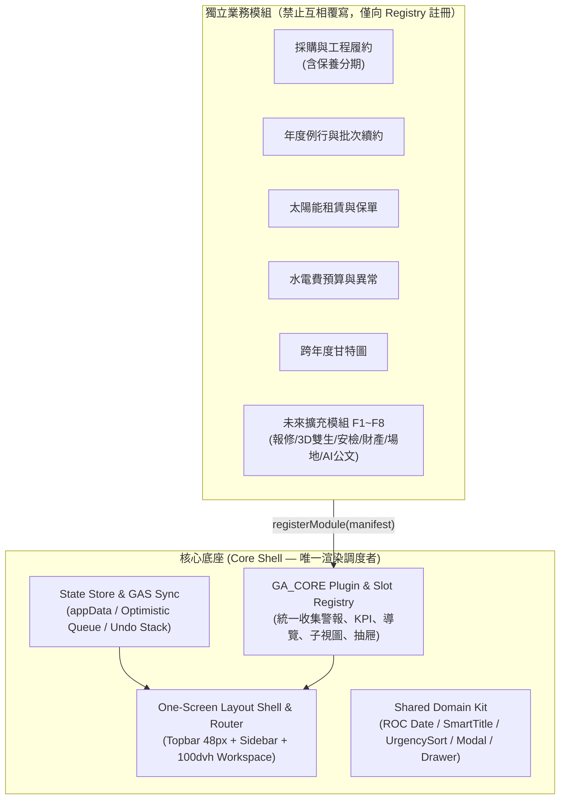

# 總務行政戰情助理 — 網頁頁面與前端架構設計規則規範書（AI 架構師與開發代理遵循憲章）

> **文件編號**：`UI_DESIGN_RULES.md`（v2.0 Architecture & UX Constitution）  
> **適用對象**：所有參與本專案開發、重構、擴充模組與介面調整之架構 AI 與工程代理（Architecture AI / Coding Agents）。  
> **最高設計哲學**：**「一屏看清全貌、零捲動不藏私、公文級高易讀、懂學校總務節奏的貼心設計、插槽化無限擴充」**。

---

## §0 AI 代理強制執行門檻（Pre-Merge Gate — 違反任一條即視為不合格）

任何 AI 在新增功能或修改畫面時，**必須逐條遵守以下 8 條鐵律**：

1. **【零捲動鐵律】**：桌機／筆電視窗在 **`1280×620` 至 `1920×1080`**（含瀏覽器工具列與 Windows 125%／150% DPI 縮放後之實際可視高度 `620px` 起），`戰情總覽` 與各 `業務子儀表板` 外層文件**絕對禁止產生垂直或水平捲軸**（`documentElement.scrollHeight <= window.innerHeight` 且 `scrollWidth <= window.innerWidth`）。
2. **【禁黑盒摺疊鐵律】**：嚴禁為了湊一屏高度，而將進行中業務塞入點擊後會撐爆頁面高度（如 `1,700px+`）的手風琴摺疊塊。必須改用**「固定高度容器 ＋ 原位時間桶分頁籤（In-Place Tabs）＋ 輕量頁碼切換」**。
3. **【禁俄羅斯娃娃覆寫鐵律】**：嚴禁再新增 `const _prev = renderCurrentView; renderCurrentView = ...` 或以正規表示式 `html.replace(...)` 劫持字串渲染；嚴禁將舊 DOM 移入 `display: none` 容器（如 `#ud-legacy-dash`）造成雙重渲染浪費。新模組一律透過**插槽註冊器（Slot Registry）**掛載。
4. **【禁 `!important` 混戰鐵律】**：統一使用 CSS `@layer`（`tokens → base → layout → components → modules → themes`）與語意化 CSS 變數，禁止跨檔案以 `html body ... !important` 互相覆蓋。
5. **【字級與防截斷鐵律】**：全站任何可見文字**最低字級不得小於 `12px`**（正文與標題 `14px`、表格與次要資訊 `13px`）；禁止在寬度 `< 160px` 的欄位對標案／例行名稱做單行 `ellipsis` 截斷。
6. **【台灣學校公文格式鐵律】**：畫面顯示之日期一律採用**民國年**（如 `115/12/09` 或 `115/12/09 (三)`），金額與數字強制啟用等寬對齊 `font-variant-numeric: tabular-nums`；底層儲存維持 ISO `YYYY-MM-DD`。
7. **【跨模組真實急迫度鐵律】**：首頁提醒排序必須依據**實際剩餘天數（`diffDays`）與法定硬死線權重**統一計算，嚴禁讓「剩 60 天的遠期黃燈」排在「剩 9 天的近期填報」之前。
8. **【公開程式碼庫資安鐵律】**：本儲存庫為公開專案，**絕對禁止**在 `.html`、`.js`、`.css`、`.md` 中硬編碼真實學校承辦個資、廠商名稱、統一編號、電話、銀行帳號、保單號碼或試算表 ID；所有業務範本一律抽離為通用 Schema 並儲存於雲端 `Templates` 表或外部匯入 JSON。

---

## §1 一屏全覽「視窗空間預算」與版面網格規範（Zero-Scroll Layout Spec）

### 1.1 響應式斷點與高度預算（Viewport Budget）

| 裝置級別 | 寬度範圍 (`vw`) | 高度範圍 (`vh`) | 捲動策略與版面模式 |
| :--- | :---: | :---: | :--- |
| **桌機標準／筆電一屏模式** | `>= 1024px` | **`>= 600px`** | **鎖定 `100dvh` 零外層捲動**。Topbar 固定 `48px`，主畫布固定 `calc(100dvh - 48px)`，內部採 2D 網格與原位分頁。 |
| **超矮視窗保護模式** | `>= 1024px` | `< 600px` | 自動解除 `overflow: hidden` 改為自然捲動，避免內容被硬性裁切（Graceful Fallback）。 |
| **平板雙欄模式** | `768px ~ 1023px` | 不限 | 左側選單收為抽屜（Drawer），主畫布採 2 欄 Bento 網格，允許外層垂直捲動。 |
| **手機巡檢模式** | `< 768px` | 不限 | 單欄卡片流 ＋ 底部固定快速操作列（Bottom Action Bar）；標題最多 2 行完整顯示、不截斷關鍵字。 |

### 1.2 戰情總覽（Business Dashboard）定案架構：「07 暖沙雙層黃金艙 × 05 特大高清晰字級」

桌機版（`>= 1024px`）正式定案採用 **「上層 6 大業務黃金指標橫列 ＋ 下層 5 : 4 : 3 黃金比例三欄執行艙」**，搭配暖沙護眼底色（`#FBF8F3`）與 **16px 特大清晰字級**，在 `100dvh` 內完整容納全部業務且零外層捲動：

```
┌───────────────────────────────────────────────────────────────────────────────────┐
│ Topbar (52px): [☰ 選單] 總務行政戰情室・民國日期・[🏦節氣提示膠囊]  [🔍搜尋 Ctrl+K] [＋新增▾] [🟢同步] │
├──────────────┬────────────────────────────────────────────────────────────────────┤
│ 左側導覽欄    │ 上層 Zone Top：六大業務健康度與法定安全橫列 (grid-cols-6, 頂部 4px 語意色條) │
│ (220px 可收折)│ [🏗️採購工程] [🔁例行續約] [☀️光電水電] [🧾小額綠優採] [🛡️法定安檢牆] [🏟️場地平面圖]│
│              ├──────────────────────────┬───────────────────────┬─────────────────┤
│ ‧ 戰情總覽    │ 下左 Zone A (5 欄, 100%高)│ 下中 Zone B (4 欄)     │ 下右 Zone C (3欄)│
│ ‧ 採購與工程  │ 🚨 近期必辦佇列 (16px大字) │ 🏗️ 執行中標案與母子勾稽 │ 📌 抬頭交辦便利貼│
│ ‧ 小額綠優採  │ [🔴7日內] [🟡30日] [🔵全覽]│                       │                 │
│ ‧ 例行與續約  │ 1. 二期光電意外險 (逾期1天) │ ‧ [115] 跑道設計監造   │ □ 校長室禮券採購 │
│ ‧ 光電與水電  │    [📋複製催辦詞]         │   進度 18%・剩4天公告  │ □ 廁所竣工圖掛載 │
│ ‧ 法定安檢牆  │ 2. 跑道設計監造 (剩4天)    │ ‧ [116] 跑道整建工程   │ □ 會計核銷規範   │
│ ‧ 場地借用圖  │    [📝簽呈與檢核 →]       │   母子連動・施工鎖操場 │                 │
│ ‧ 3D 校舍雙生 │ 3. 能源申報系統 (剩5天)    │ ‧ [116] 飲水機維護12期 │ [＋記一筆 Enter] │
│              │          [◀ 第 1 / 3 頁 ▶]│   連動設備台數與季水質 │ ⚡7件續約批次精靈│
│ [本週日期膠囊]│                          │                       │                 │
└──────────────┴──────────────────────────┴───────────────────────┴─────────────────┘
```

#### 各區域像素與互動約束：
- **左側導覽欄 (`#app-sidebar`)**：
  - 支援三態切換：**展開 (`220px`)** ↔ **窄圖示軌 (`56px`)** ↔ **完全收合 (`0px`)**。
  - **自適應高度保護**：當 `window.innerHeight < 760px` 時，側欄月曆自動縮為**「單列本週日期膠囊（點擊彈出浮動完整月曆）」**，確保側欄零捲軸、底部同步燈永遠可見。
  - **手機版文案修正**：`< 1024px` 時左上角顯示 `☰ 選單`（而非桌機的 `☰ 收合選單`）。
- **上層 Zone Top（六大業務黃金指標橫列 — `grid-cols-6`）**：
  - 固定 6 張頂部帶 `4px` 語意色條之純白指標卡（`🏗️ 採購工程`、`🔁 例行與續約`、`☀️ 光電與水電`、`🧾 小額・綠採・優採`、`🛡️ 法定安檢牆`、`🏟️ 場地借用圖`），字體採用 `26px～28px` 粗黑等寬數字 ＋ 單行精準狀態摘要，點擊任一卡直達對應雙欄子頁。
- **下左 Zone A（近期必辦佇列 — 佔 5/12 寬）**：
  - 內建原位時間桶切換（`🔴 7日內` / `🟡 30日預告` / `🔵 全覽`）與右下頁碼 `[◀ 1/3 ▶]`，依容器高度自動計算每頁列數，每筆標題 **16px 粗體**、附下一步行動說明與 `📋 複製催辦詞／簽呈稿` 按鈕。
- **下中 Zone B（執行中標案與里程碑 — 佔 4/12 寬）**：
  - 直接呈現全校執行中標案進度條、補助／上級死線與母子案連動狀態，點擊秒進左右雙欄檢核台。
- **下右 Zone C（抬頭交辦便利貼 — 佔 3/12 寬）**：
  - 直接顯示待辦 Memo 清單 ＋ 快速輸入框 ＋ 年末批次續約快捷入口，不再藏入彈窗。

### 1.3 各業務子分頁「一屏左右雙欄 Master-Detail」設計規則

所有業務子分頁（採購履約、小額綠優採、例行事務、太陽能租賃、水電費監控、場地借用圖）均須遵守**「左右雙欄同屏控管」**，禁止無上限向下堆疊：

1. **採購標案詳情頁（終結 `4,210px` 捲動）**：
   - 頂部：精簡案頭橫幅（案號、智慧簡稱、狀態膠囊、預算／決標、完成率、**依採購性質動態過濾之工具鈕**）。
   - 主體採**左右雙欄 Split-Pane**：
     - **左欄（`280px` 階段導覽樹）**：列出第 1～N 階段名稱、狀態圓點、完成比例與預定迄日，開啟時**自動選中目前「進行中／最近待辦」階段**。
     - **右欄（彈性寬度，單一階段工作台）**：完整顯示當前選中階段之 `16px` 大字檢核清單、公文文號、日期與公文範本按鈕（或切換分期付款／材料送審），點左欄一下秒切期別，**永遠零長捲動**。
2. **水電費監控頁**：頂部整合篩選與預算進度條；左欄（`58%`）呈現「1～12 月本年 vs 去年同期長條對照圖」與超約警示，右欄（`42%`）為「異常與歷史帳單分頁表」；所有按鈕強制 `white-space: nowrap`。
3. **太陽能租賃頁**：頂部 KPI **「本年應收金額」優先整合 `rent_terms_json` 各期排程與 `Solar_Records` 實收紀錄**；左欄為契約卡清單，右欄同屏載入選中契約之「繳納時程／對帳／雙保險／保證金」頁籤。
4. **例行事務頁**：支援 **「📋 分組雙欄視圖（左分組清單、右作業步驟與檔案）」↔「🗓️ 1～12 月年度矩陣視圖」** 切換；同月份 $\ge 3$ 筆續約案自動浮現「⚡ 批次轉開下年度採購案」。

---

## §2 內容易讀性、色彩語意與排版標準（07 暖沙配色 × 05 特大字 Tokens）

### 2.1 單一來源 CSS Design Tokens（禁止硬編碼色碼）

```css
@layer tokens {
  :root {
    /* 07 暖沙雙層黃金艙 — 背景與表面階層 */
    --bg-canvas: #FBF8F3;       /* 溫潤暖沙底色，大螢幕長時間閱讀低眩光 */
    --bg-topbar: #F5EFE6;
    --bg-surface: #FFFFFF;      /* 純白高對比卡片表面 */
    --bg-subtle: #FAF6F0;
    --border-subtle: #E7DFD3;
    --border-strong: #D6CBB9;

    /* 文字對比階層（全數符合 WCAG AAA/AA 高對比） */
    --text-primary: #1C1917;    /* 對比度 16.5:1 — 標題、主名稱、金額 */
    --text-secondary: #44403C;  /* 對比度  9.6:1 — 表格內文、檢核文字 */
    --text-muted: #57534E;      /* 對比度  6.8:1 — 輔助說明（清晰不發灰） */

    /* 語意色彩系統（暖棕主色 × 青綠輔色 × 紅橘綠燈號） */
    --brand-primary: #7C4A21;   /* 沉穩胡桃暖棕 — 主標題、主按鈕、選中態 */
    --brand-accent: #0D9488;    /* 松石青綠 — 進度百分比、正向指標 */
    --brand-soft: #F5EDE3;
    --status-danger: #DC2626;   /* 逾期、違約、法定死線 <=3 天、超支 */
    --status-danger-bg: #FEF2F2;
    --status-warn: #B45309;     /* 14 日內即將到期、待補件、預警 */
    --status-warn-bg: #FFFBEB;
    --status-ok: #047857;       /* 已完成、已撥款入帳、法規達標 */
    --status-ok-bg: #ECFDF5;

    /* 05 號特大高清晰字級階梯（專為 1920×1080 大螢幕零眼壓調校；筆電 <1440px 自動微縮 1px） */
    --fs-xs: 12.5px;   /* 徽章、星期標記（全站絕對下限） */
    --fs-sm: 14px;     /* 次要說明、表格輔助欄、行動膠囊按鈕 */
    --fs-base: 16px;   /* 業務項目主標題、檢核項文字、表單輸入（特大清晰字級！） */
    --fs-lg: 18px;     /* 區塊面板標題、彈窗標題 */
    --fs-kpi: 28px;    /* 上排黃金指標卡核心數值 */
    --gap-canvas: 16px;
    --pad-panel: 16px 18px;
  }
}
```

### 2.2 智慧去前綴與反截斷規則（Smart Title & Anti-Truncation）

1. **自動剝離冗餘機關與年度前綴（`formatSmartTitle(rawTitle, context)`）**：
   - 在戰情室列表、模組卡片、甘特圖左欄與手機版中，顯示層自動將與 `appData.schoolName` 重複之字樣（如 `高雄市立○○國民中學`、`○○國中`）剝離，並將開頭年度（如 `115年`、`116年度`）轉為獨立窄徽章 `[116]`。
   - 範例：原始案名 `115年○○國中跑道及周邊設施整建工程委託設計監造勞務採購` → 戰情顯示 `[115] 跑道及周邊設施整建（委託設計監造）`，核心關鍵字 **100% 完整露出**，滑鼠懸停 `title` 屬性仍保留法定全銜（列印正式報表與公文複製時一律使用法定全銜）。
2. **雙行上限取代單行腰斬**：
   - 窄容器（`< 280px`）內之項目名稱一律採用 `-webkit-line-clamp: 2`（最多 2 行），嚴禁單行 `white-space: nowrap` 把標題裁成 4 個字。
3. **預警列「標的 ＋ 具體行動」雙語意結構**：
   - 每一筆提醒必須明確呈現 **「[類別籤] 智慧簡稱 — 下一步具體動作」**。
   - 正確範例：`[太陽能意外險] 二期屋頂光電（教室／警衛室／央廚） — 請催廠商補送續保單備查`（而非僅顯示地名）。

### 2.3 全站統一「跨模組真實急迫度排序公式」（Unified Urgency Score）

所有模組（採購階段、法定死線 `sla_deadline`、例行事務、太陽能租金／保單／續租、水電異常、交辦 Memo）產出之提醒物件，必須包含標準欄位 `{ id, module, level, dueDate, isStatutorySla, title, actionHint, onAction }`，並統一按以下優先序排序：

1. **Tier 0（已逾期／異常紅燈，`daysLeft < 0`）**：按逾期天數由久至近排序。
2. **Tier 1（7 日內必辦，`0 <= daysLeft <= 7`）**：無論來自哪一模組，只要 7 天內到期一律升為橘紅高優先，法定／補助死線（`isStatutorySla = true`）置頂。
3. **Tier 2（30 日內預告，`8 <= daysLeft <= 30`）**：依 `daysLeft` 由小至大嚴格遞增排序（確保 **剩 9 天的填報永遠排在剩 21 天的催繳之前**）。
4. **Tier 3（遠期追蹤，`daysLeft > 30`）**：即使模組設定提前 60 天預告（如保險或優先續租），只要 `daysLeft > 30`，一律歸入「30 日後／遠期預告」籤，**禁止佔用首頁「緊急與 7 日內」版面**。

### 2.4 民國年與金額格式標準

- **顯示格式**：全站統一使用 `formatRocDate(ymd, { withWeekday })` → `115/12/09` 或 `115/12/09 (三)`；搭配相對天數顯示為 `115/12/09（剩 13 天）`。
- **輸入體驗**：封裝通用日期選擇元件（保留原生月曆點選便利性，同時在欄位右側即時顯示 `民國 115 年 12 月 09 日`，並允許使用者在快速輸入框直接鍵入 `115/12/09` 或 `1151209` 自動解析為 `2026-12-09`）。

---

## §3 學校總務「貼心體驗設計」標準規範（Empathetic UX Rules）

1. **條件式精準工具列（Context-Aware Actions）**：
   - 工具列按鈕必須定義 `when(record)` 條件函式：
     - `📅 各期日期自動推估`、`📥 比對匯入分期明細`：僅在 `flags.is_maintenance === true || procurement_type === '勞務'` 時顯示（純工程案隱藏，或收進「更多工具 ▾」）。
     - `🧱 材料送審`、`👥 附表二權責分工`：僅在 `procurement_type === '工程'` 時顯示。
2. **學校雙曆制「總務節氣膠囊」（School Calendar Awareness）**：
   - Topbar 自動依當前月份顯示非干擾式膠囊提示（點擊可篩選對應事項）：
     - `11/15 ~ 12/25`：`🏦 會計關帳與下年度續約期（尚有 N 件待辦）`
     - `01/20 ~ 02/15` ＆ `08/05 ~ 08/30`：`🏫 開學前校園安檢與水塔／環境整備期`
     - `06/25 ~ 08/25`：`🏗️ 暑假校舍修繕施工黃金期`
3. **一鍵複製催辦與簽呈助手（Actionable Copy Snippets）**：
   - 凡涉及「向廠商催繳保單／租金／履約進度」或「請購動支／分期核銷」之節點，提供 `📋 複製催辦詞` 與 `📞 廠商聯絡資訊` 浮層，點擊即複製填好案名、日期與條號之禮貌公務訊息至剪貼簿。
4. **關聯標案母子勾稽（Linked Projects）**：
   - `Projects` 支援選填關聯案號（存放於 `flags_json.linked_project_id`）：例如「跑道委託設計監造勞務案」與「跑道整建工程案」互相連結，在詳情頁頂部可一鍵互跳，且前案設計核定日延後時自動提示後案發包死線風險。
5. **全站 8 秒復原機制（Undo Toast）**：
   - 針對「例行事項完成打卡」、「Memo 完成／刪除」、「檢核項刪除」、「批次日期覆寫」，執行前先暫存快照（Snapshot），底部 Toast 顯示 `✅ 已更新 ── [↩ 復原]`（8 秒內點擊即無損還原本地與雲端狀態）。

---

## §4 前端目標模組化架構（Clean Slot Architecture — 供架構 AI 實作遵循）



### 4.1 模組註冊標準介面（Module Manifest Contract）

架構 AI 新增任何功能模組時，**必須**透過統一註冊介面宣告，而非改寫全域渲染函式：

```javascript
window.GA_CORE.registerModule({
  id: 'campus-repair',                // 唯一模組代號
  title: '校舍報修',                   // 側欄與模組磚短名（<= 5 字）
  navGroup: 'ops',                    // 歸屬側欄分組：'overview' | 'procurement' | 'ops' | 'assets'
  icon: '🛠️',
  getSummaryTile(appData) {           // 供戰情室 Zone B 模組健康度矩陣使用（固定格式）
    return { count: 4, unit: '件待修', redCount: 1, amberCount: 2, hint: '北棟3F漏水' };
  },
  getAlerts(appData, today) {         // 供戰情室 Zone A 統一急迫度引擎收集排序
    return [/* 標準 Alert 物件陣列 */];
  },
  renderView(container, state) {      // 必須遵守 Master-Detail 100dvh 零外層捲動規範
    /* 渲染本模組一屏雙欄子儀表板 */
  },
  projectToolbarActions: [            // 條件式掛載至標案詳情頁（非相關標案自動隱藏）
    { id: 'link-repairs', label: '🛠️ 關聯報修單', when: p => p.procurement_type === '工程', onClick: p => {} }
  ]
});
```

---

## §5 未來擴充藍圖與 8 大潛在新功能設計定義（Future Capabilities Specification）

為確保未來持續加入新業務時**永遠不破壞一屏全覽、不撐爆左側選單、不污染公開程式碼庫**，特預先定義以下 **8 大擴充模組**之介面、資料與空間規範：

### 5.1 導覽欄與首頁「無限擴充不爆版」保護機制
1. **左側導覽欄四分組上限**：側欄固定分為 4 大領域群組（`📊 戰情與排程`、`🏗️ 採購與工程`、`⚡ 設施與能源`、`🧰 校產與服務`），每群組可摺疊；同時支援 **`Ctrl+K`／`Cmd+K` 全域指令面板（Command Palette）** 秒跳任意功能與標案。
2. **首頁 Zone B 模組磚上限 6 格**：首頁固定顯示最核心 6 格模組健康磚（`2×3` 網格）；當啟用模組超過 6 個時，第 6 格自動變為「`➕ 更多模組 (N)`」切換卡或允許使用者釘選常用 5 格，**保證首頁高度永遠多 0px**！

---

### 5.2 八大未來擴充模組逐項設計定義

#### 【模組 F1】小額與法定採購三軌控管台帳（§14 防拆單 × 🌿 綠色採購 × 🤝 優先採購，`Statutory_Purchases`）
- **定位決策**：供總務承辦人自行登錄日常小額請購核銷，並**自動雙向匯總正式標案（`Projects`）之決標／核銷金額**，達成「一筆支出輸入、三軌法定指標即時試算」，免除重複建檔與年底湊比率壓力。
- **三大法定分流計算邏輯（嚴禁分母混算）**：
  1. **《政府採購法》§14 同性質小額累計防拆單**：依「同性質標的分類（如水電零星修繕、冷氣維修、印刷製品、清潔環境、資訊耗材…）」統計本年度小額累計金額；達 `120,000 元 (80%)` 亮橘燈預警、達 `150,000 元` 亮紅燈攔截提示改採公開取得。
  2. **🌿 機關綠色採購法定比率（目標預設 $\ge 95\%$，可自訂）**：欄位設為 `非指定品項（不計入分母）` ｜ `指定品項・具環保標章（進分子+分母）` ｜ `指定品項・無標章未專簽（只進分母，拉低達成率！）` ｜ `指定品項・已簽准不統計`。新增無標章指定品項時即時試算警示：「此筆入帳後年度綠採率將降至 XX%」。
  3. **🤝 身心障礙優先採購法定比率（義務項目門檻 $\ge 5\%$）**：欄位設為 `非義務品項（不計入分母）` ｜ `義務品項（餐盒／印刷／清潔／禮品等）・一般廠商（只進分母）` ｜ `義務品項・優採合格機構（進分子+分母）`。面板直接換算白話提示：**「目前優採率 3.8%，尚差 $X,XXX 元達標 5%」**。
- **一屏雙欄介面設計**：
  - 頂部：三張法定安全尺規大字卡（`§14 最高分類累計`、`🌿 年度綠採達成率 %`、`🤝 年度優採達成率 % 與達標差額`）。
  - 左欄（`62%`）：年度小額與法定採購快速登錄列 ＋ 分類／季度篩選清單（支援一鍵篩出「本季綠採／本年優採對帳清單」供申報網登打）。
  - 右欄（`38%`）：各同性質類別 §14 累計排行條 ＋ 單筆憑證／標章編號／不統計簽准文號檢視編輯。

#### 【模組 F2】3D 校園數位雙生空間戰情整合（`campus-3d.html` 雙向橋接）
- **解決痛點**：現有 `campus-3d.html` 模型精緻但與業務資料脫鉤，且無返回主系統導覽。
- **空間錨點契約（`Spatial_Bindings`）**：以標準空間代碼（如 `BLD-MAIN-RF`、`BLD-KITCHEN`、`FAC-TRACK`、`RESTROOM-E-2F`）連結 `Projects`、`Solar_Contracts`、`Utilities_Meters` 與 `Venue_Bookings`。
- **介面整合規範**：
  1. `campus-3d.html` 左上角固定加入 **「← 返回戰情室」** 膠囊鈕，並支援 URL 參數定位（如 `campus-3d.html?focus=FAC-TRACK&project=XP1160101`）。
  2. 在 3D 場景開啟「總務戰情圖層」時，施工中區域（如跑道）自動浮現工程進度標籤、屋頂太陽能顯示發電合約狀態、已外借場地顯示借用時段；點擊空間滑出「歷年修繕履歷 ＋ 竣工圖說（`campus-3d-assets`）＋ 保固期限」。

#### 【模組 F3】校園安全與法定安檢合規證照牆（`Safety_Compliance`）
- **解決痛點**：消防安檢、建築物公共安全檢查、高低壓電氣設備定期檢測、電梯許可證、兒童遊戲場檢驗、飲水機水質檢驗、樹木褐根病巡檢散落各處，督學視導時難以一頁佐證。
- **一屏介面設計**：
  - 採用 **「一屏合規燈號矩陣（8～12 張證照卡網格）」**，每張卡顯示：法定項目、主管機關、最近合格日、下次申報期限、合格證字號與雲端掃描檔連結。
  - 若有「複檢缺失改善中」項目，自動連動戰情室 Zone A 紅橘燈並可一鍵轉開改善採購案。

#### 【模組 F4】財產設備生命週期、冷氣／飲水機履歷與耗材安全庫存（`Asset_Inventory`）
- **解決痛點**：班級冷氣、飲水機濾心、燈管、清潔防災物資庫存不明；飲水機台數增減影響維護契約單價（如飲水機契約第 15 條）；財產達耐用年限待報廢清冊整理費時。
- **資料與連動設計**：
  - 記錄重要設備配置點位（連動 3D 空間代碼）、安裝日、保固迄日、對應維護契約 `project_id`。
  - 當設備報廢或新增時，自動彈出提示：「此變動影響《年度飲水機／冷氣維護契約》設備台數，是否同步調整後續分期金額？」
  - 耗材低於安全庫存量時，自動進入戰情室「30 日內預告」提醒請購。

#### 【模組 F5】校園場地短期借用「平面圖面 × 時段視覺看板」（`Venue_Map_Board`）
- **階段策略（依使用者定案）**：學校場地外借以短期借用為主；**第一階段聚焦「圖面與時間視覺化」**，讓承辦人一眼看清目前各空間借用與施工鎖場情形；收費與保證金計價規則預留 `Venue_Rules` 結構供後續載入。
- **一屏雙欄介面設計**：
  - 左欄（`58%`）：**互動式校區場地配置平面圖**（標示運動場跑道、風雨球場、活動中心／禮堂、食育教室、會議室、一般教室等區塊），支援切換「今日 ／ 本週末 ／ 指定日期」，空間區塊直接以語意色塊呈現：`🟢 空閒可借`、`🔵 已借用（直接顯示借用單位＋時段，如 09:00-12:00 社區羽球）`、`🚧 工程施工鎖場禁借（自動連動工程標案履約工期！）`。
  - 右欄（`42%`）：當週短期借用時間軸清單 ＋ 快速登記借用單（空間、日期、起迄時段、借用單位、聯絡人、備註，並預留場地費／冷氣費／保證金欄位供日後套用規則）。

#### 【模組 F6】AI 總務公文簽呈、驗收紀錄與催辦草稿助手（`Doc_Copilot`）
- **解決痛點**：總務人員大量時間耗費於撰寫重複性簽呈（動支請購、限制性招標簽准、評審小組成立、工期展延、歲出保留說明、驗收紀錄）。
- **設計與資安規範**：
  - 於標案詳情頁與例行事項右側工作台內建 **「📝 產生公文／簽呈草稿」**。
  - 純本機端依標案結構化欄位（預算、採購法條次、等標期、補助比例、契約條號）即時套印出符合台灣機關公文用語之「主旨／說明／擬辦」段落，支援一鍵複製貼入公文系統，**全程不將未公開底價或個資傳送至未授權外部伺服器**。

#### 【模組 F7】多角色視角切換與一鍵職務交接包（`Role_Views & Handover` — 次階段備用）
- 設定選單支援 **「📦 產出職務交接清冊 PDF」**：一鍵彙整全校未結標案現況、年度例行時程表、開口／維護契約廠商通訊錄與雲端資料夾索引。

#### 【模組 F8】晨間主動推播與行動端現場拍照驗收模式（`Notify_Field_Mode` — 次階段備用）
- 手機開啟系統時支援現場拍照直傳雲端資料夾並掛載至檢核項。

---

## §6 架構 AI 交付前自動化驗收腳本基準（Mandatory Automated Verification）

架構 AI 完成任何頁面開發或重構後，除了通過既有 `node --check *.js` 與功能單元測試外，**必須在無頭瀏覽器中針對 `1366×650`（學校筆電實質視窗）、`1440×820` 與 `1920×1080`（主力大螢幕）執行以下 DOM 驗收斷言且全數為 `true`**：

```javascript
function verifyDesignRulesCompliance() {
  const vw = window.innerWidth, vh = window.innerHeight;
  const docNoScroll = vw >= 1024 && vh >= 600
    ? (document.documentElement.scrollHeight <= vh + 1 && document.documentElement.scrollWidth <= vw + 1)
    : true;

  // 1. 禁止隱形殭屍儀表板容器
  const noGhostDom = !document.getElementById('ud-legacy-dash');

  // 2. 字級下限檢查（可見文字節點不得 < 11.9px）
  const smallTextNodes = [...document.querySelectorAll('body *')].filter(el => {
    if (el.children.length > 0 || !el.innerText?.trim()) return false;
    const cs = getComputedStyle(el);
    const r = el.getBoundingClientRect();
    return cs.display !== 'none' && r.width > 0 && r.height > 0 && parseFloat(cs.fontSize) < 11.9;
  });

  // 3. 禁止窄於 120px 的單行標題截斷
  const badTruncations = [...document.querySelectorAll('body *')].filter(el => {
    const cs = getComputedStyle(el);
    return cs.display !== 'none' && cs.textOverflow === 'ellipsis'
      && el.clientWidth > 0 && el.clientWidth < 120 && el.scrollWidth > el.clientWidth + 4;
  });

  return {
    pass: docNoScroll && noGhostDom && smallTextNodes.length === 0 && badTruncations.length === 0,
    viewport: `${vw}x${vh}`,
    docNoScroll,
    noGhostDom,
    smallTextCount: smallTextNodes.length,
    badTruncationCount: badTruncations.length
  };
}
```

---

## §7 使用者已拍板定案之核心決策紀錄（Confirmed Alignment Decisions）

架構 AI 實作時應直接遵循以下經使用者兩輪確認之最終定案，無須重複詢問：

1. **戰情首頁定案版面與字級風格**：
   - **結構與配色採用「07 號｜暖沙雙層黃金艙」**：溫潤暖沙底色（`#FBF8F3`）＋ 胡桃暖棕／松石青綠重點色；上層為 **6 大業務健康指標橫列**，下層為 **`5 : 4 : 3` 黃金比例三欄（近期必辦佇列 ｜ 執行中標案 ｜ 抬頭交辦便利貼）**。
   - **字體混搭「05 號｜特大高清晰字級」**：以 `1920×1080` 桌機大螢幕為主力，主項目文字放大至 **`16px`**、區塊標題 **`18px`**、次要與按鈕 **`14px`**、指標數字 **`28px`**，留白寬裕零眼壓，且全畫面鎖定 `100dvh` 零外層捲動。
2. **全業務子頁面互動標準**：標案詳情（12～13 階段）、小額綠優採、例行事務、太陽能租賃、水電費監控、場地借用圖一律採用 **「左右雙欄同屏控管（Split-Pane Master-Detail）」**，點左欄導覽秒切右欄細節，徹底消除長捲軸。
3. **小額採購、綠色採購與優先採購整合定案（`F1`）**：
   - 獨立設立專供總務自記控管的 **「🧾 小額與法定採購」** 模組（不混入一般教師報修），採**「單筆登錄 ＋ 自動匯總 `Projects` 大標案、三軌獨立分母精算」**：同時控管 **① 採購法 §14 同性質小額 15 萬上限**、**② 🌿 綠色採購指定品項達成率（目標 $\ge 95\%$）**、**③ 🤝 身障優先採購義務品項達成率（法定 $\ge 5\%$ 及尚差金額提示）**。
4. **短期場地租借第一階段定案（`F5`）**：
   - 先實作 **「🏟️ 校區平面圖面 × 日期時段視覺看板」**，於平面圖上直覺呈現各空間目前為「空閒／已租借單位與時段／工程施工自動鎖場」，並預留規則結構供使用者後續補入收費標準。
5. **其餘確認優先藍圖與資安策略**：
   - 依序整合 `F6 公文簽呈／催辦複製與年末批次續約精靈`、`F2 3D 校舍雙向資料連動`、`F3 法定安檢證照牆`、`F4 設備與耗材庫存（連動維護契約台數）`。
   - 公開 GitHub 儲存庫中既有硬編碼之特定廠商統編、電話、保單號於重構時移回雲端試算表或匯入檔，保持程式碼純淨安全。


