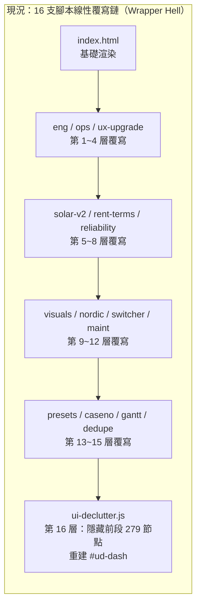

# 總務行政戰情助理 — 全系統頁面、架構、易讀性與貼心設計深度檢討報告

> **檢視範疇**：全站主系統（[index.html](file:///home/antigravity/giligilau-WOS/Office-assistant/index.html) 與 16 支外部模組共 16,996 行）＋ 3D 校園模型（[campus-3d.html](file:///home/antigravity/giligilau-WOS/Office-assistant/campus-3d.html) 6,625 行），合計 **23,621 行程式碼**；涵蓋 7 大業務分頁、8 種真實螢幕／瀏覽器可用視窗尺寸與行動端實測。

---

## 壹、核心診斷摘要（為什麼目前仍無法「免捲動看清全貌」？）

經過多輪功能擴充與局部介面調整後，目前系統出現了三個結構性矛盾，導致使用者在日常操作時依然感受到**「需要不斷捲動」、「看不到業務全貌」、「重要字句被截斷」**以及**「缺乏貼心輔助」**：

1. **「單欄縱向堆疊 ＋ 黑盒摺疊」造成的假一屏現象**
   - [ui-declutter.js](file:///home/antigravity/giligilau-WOS/Office-assistant/ui-declutter.js#L94-L99) 將戰情總覽改為 `flex-direction: column` 上、中、下三層單欄垂直堆疊（急件列 ＋ 5 張模組卡 ＋ 快速入口），內容固有高度達 **727px**（加計頂部導覽列需 **802px** 視窗高度）。
   - 在學校行政最常見的筆電實質瀏覽器視窗（扣除系統工作列、Chrome 分頁列與書籤列後，可用高度僅 **614px～720px**）下，首頁必然產生垂直捲軸，底部的「⚡ 快速入口」整塊掉出畫面外；連左側固定選單欄（`scrollHeight: 727px`）在筆電上也會切掉底部的同步狀態燈與傳送門。
   - 更關鍵的是：**「不捲動」若靠「把 80% 進行中業務藏進『其他進行中 N 件 ▼』摺疊鈕」來達成，就犧牲了「看清全貌」**。未點開時，承辦人看不見下週即將到期的填報與年底續約案；一旦點開，畫面高度瞬間暴增至 **1,787px**（溢出 **962px**），再度退回長捲軸頁面。
2. **「戰情首頁」與「6 大業務子分頁」體驗斷裂**
   - 即使首頁勉強壓縮高度，只要點進「例行事務」、「水電費監控」、「太陽能租賃」或「採購標案詳情」，頁面立刻變成 **1,600px～4,210px** 的傳統長捲動網頁（標案詳情頁 12～13 個階段全展開時需連續滾動 5 個螢幕高），缺乏現代業務儀表板的 **Master-Detail（左總覽清單／右細節抽屜）一屏控管架構**。
3. **13 層「俄羅斯娃娃式」函式覆寫與殭屍 DOM 架構債**
   - 全站共有 **13 處**對 `renderCurrentView` 的連鎖劫持覆寫，且每次重繪首頁時，前段模組先建立 **279 個舊版儀表板 DOM 節點**，最後再由 [ui-declutter.js](file:///home/antigravity/giligilau-WOS/Office-assistant/ui-declutter.js#L523-L527) 整包塞入隱藏容器 `#ud-legacy-dash`（僅 **130 個節點**實際顯示，**高達 68.2% 為無效隱形渲染**），同時累積了 **725 處 `!important`** 樣式衝突，造成後續任何版面微調極易牽一髮動全身。

---

## 貳、全站各頁面「一屏全覽與版面空間」實測檢討

### 一、各解析度與各業務分頁溢出實測數據

| 檢視畫面／模擬真實視窗情境 | 視窗尺寸 (`vw × vh`) | 垂直溢出量 (`overflowPx`) | 實測發現之具體版面問題 |
| :--- | :---: | :---: | :--- |
| **戰情總覽（外接大螢幕）** | `1920 × 1080` | `0 px` | 畫面下半部留白過多，但中間 5 張模組卡內文字仍被單行截斷；20+ 件進行中業務被隱藏於摺疊列。 |
| **戰情總覽（14 吋筆電含瀏覽器列）** | `1440 × 780` | **`+22 px`** | `#ud-dash` 出現內捲軸，底部「3D 校舍模型」按鈕被切邊。 |
| **戰情總覽（學校常見行政筆電實質視窗）** | `1366 × 650` | **`+152 px`**（主區） **`+77 px`**（側欄） | **「⚡ 快速入口」與 Memo 輸入框完全消失於螢幕下方**；左側欄底部的雲端同步燈號與傳送門被截斷。 |
| **戰情總覽（1080p 開啟 Windows 150% 縮放）** | `1280 × 614` | **`+188 px`**（主區） **`+113 px`**（側欄） | 僅能看到急件列與半排模組卡，模組卡標題僅剩 **65px～87px** 可視寬度。 |
| **戰情總覽（展開「其他進行中」後）** | `1440 × 900` | **`+962 px`** | 總高度暴增至 **1,787px**，下方模組概況與快速入口被推至第 2～3 螢幕深處。 |
| **採購標案詳情頁（12～13 階段案）** | `1440 × 820` | **`+3,390 px`** | 全階段卡片垂直全展開，總高達 **4,210px**；每次進頁都要長距離捲動尋找目前進行中的那一期。 |
| **水電費監控分頁** | `1440 × 820` | **`+1,050 px`** | 上方預算卡與中間電錶卡各只佔左半 40%（右側 60% 大片空白），卻把最核心的「年度同期月度走勢圖」與「異常帳單表」擠出第一屏外！ |
| **例行事務分頁（20+ 項列管）** | `1440 × 820` | **`+811 px`** | 所有例行業務平鋪為單一長表，年底同日到期的多筆續約案洗版，無法一眼看清「本月／下月／各季」全貌。 |
| **太陽能租賃分頁** | `1440 × 820` | **`+131 px`** | 頂部 4 張大 KPI 卡 ＋ 重複的預警清單佔據過半高度，第 3 份契約卡片下半部被切斷。 |
| **行動端（手機直向巡檢）** | `390 × 844` | `+438 px` | 左上角按鈕誤顯示桌機文案「`☰ 收合選單`」（實為開啟選單），急件標題僅剩 `78px` 寬度幾乎無法閱讀。 |

### 二、各業務分頁關鍵結構問題

1. **戰情總覽（Dashboard）**
   - **浪費橫向寬度**：在 `1440px～1920px` 寬螢幕上，急件列每一列長達 `1,100px+`，中間大片空白，卻因上下三區單欄堆疊而撐破 `720px` 高度。若改為 **2D Bento 雙欄／三欄網格**（例如左側 60% 為「分頁籤時間桶行動雷達」、右側 40% 上下配置「各模組健康度矩陣」與「即時可見的交辦 Memo 清單＋快填」），即可在 `620px` 高度內 100% 零捲動呈現所有區塊！
   - **交辦 Memo 清單從首頁消失**：改版後首頁只剩「快速記一筆交辦」輸入框，原本記錄的重要待辦事項本身卻必須點進「各模組概況 → 交辦 Memo」彈窗才看得到，失去了便利貼「抬頭即見」的核心價值。
2. **水電費監控（Utilities）**
   - 空間利用率極低：頂部篩選列佔 2 行、預算卡片只放 1 張卻獨佔整層高度、電錶卡片只放 1 張又獨佔整層高度（且電錶卡內「`＋ 帳單`」按鈕因缺少 `white-space: nowrap` 被擠壓成直書三行 `＋ / 帳 / 單`），真正需要視覺判讀的「1～12 月同期用電／金額對照圖」在第一屏只露出頂端 15%。
3. **太陽能租賃（Solar）**
   - **KPI 數據與契約排程脫鉤**：頂部 KPI 卡「本年應收／實收回饋金」僅統計已手動建入 `Solar_Records` 的對帳單；當契約繳納時程（`rent_terms_json`）明明載明年底有一筆應收年租金、但承辦人尚未建立對帳單時，KPI 竟顯示「`0 元 ／ 應收 0 元`」，極易造成財務誤判。
   - **資訊重複堆疊**：戰情首頁已顯示太陽能預警，進入太陽能分頁又用大篇幅重複列出相同 3 筆預警橫幅，把下方的契約主檔卡片擠出畫面外。
4. **採購與履約詳情頁（Project Detail）**
   - **工具列無差別塞入不相關按鈕**：在公開招標的「大型工程標案」詳情頁上方，仍顯示僅適用於年度分期保養勞務案的「`📅 各期日期自動推估／調整`」與「`📥 比對匯入分期明細`」，造成視覺干擾與誤按風險。
   - **缺乏階段收合與聚焦導覽**：無論已完成、進行中或半年後才開始的第 12 期階段，全部以同等高度展開。
5. **3D 校園模型（`campus-3d.html`）**
   - 以 `target="_blank"` 另開新分頁後，介面內**沒有「← 返回總務戰情室」按鈕**；且模型中的校舍、屋頂光電棚架、中央廚房、廁所與跑道，尚未與主系統的標案進度、太陽能契約、水電錶或報修紀錄串聯，停留在純靜態展示。

---

## 參、前端與資料架構設計檢討（Architecture Audit）

1. **函式猴子補丁（Monkey-Patching）失控**：
   - `renderCurrentView` 被覆寫 **13 次**、`openProjectWizard` 與 `submitNewProject` 各被覆寫 **3 次**、`renderProjectDetailHTML` 與 `buildAllAlerts` 各被覆寫 **3 次**。任何一層若在字串 `html.replace(...)` 時因前一層改了一個按鈕文字而匹配失敗，功能就會靜默消失（Silent Failure）。
2. **CSS 特異度軍備競賽與死碼堆積**：
   - 全專案累計 **725 處 `!important`**（其中 [theme-nordic-agenda.js](file:///home/antigravity/giligilau-WOS/Office-assistant/theme-nordic-agenda.js) 佔 351 處、[layout-theme-switcher.js](file:///home/antigravity/giligilau-WOS/Office-assistant/layout-theme-switcher.js) 佔 131 處、[ui-declutter.js](file:///home/antigravity/giligilau-WOS/Office-assistant/ui-declutter.js) 佔 31 處）。
   - [theme-paper-journal.js](file:///home/antigravity/giligilau-WOS/Office-assistant/theme-paper-journal.js)（796 行）已未載入卻仍留存於根目錄；[layout-theme-switcher.js](file:///home/antigravity/giligilau-WOS/Office-assistant/layout-theme-switcher.js) 的 4 種版面切換器被 [ui-declutter.js](file:///home/antigravity/giligilau-WOS/Office-assistant/ui-declutter.js#L196-L197) 用 `:nth-child` 硬性隱藏；卡片進度底色先由 `theme-nordic-agenda.js` 計算渲染，再被 `ui-declutter.js` 以 `display: none !important` 抹除。
3. **公開程式碼庫（Public Repository）資料耦合風險**：
   - [solar-rent-terms.js](file:///home/antigravity/giligilau-WOS/Office-assistant/solar-rent-terms.js) 與 [project-timeline-presets.js](file:///home/antigravity/giligilau-WOS/Office-assistant/project-timeline-presets.js) 將特定機關標案、廠商名稱、統一編號、聯絡人姓名電話、公證字號與保單字號直接寫死於前端程式碼中。公開 GitHub 專案應嚴格遵守 **「程式邏輯與業務個資分離（Code-Data Separation）」**，所有預設範本應存放於雲端試算表 `Templates` 表或透過 JSON 匯入。

---

## 肆、內容易讀性（Readability）六大痛點

1. **重複前綴吃掉核心資訊（嚴重截斷）**：
   - 實測在 `1366px` 螢幕下，首頁 5 張模組卡每張內部文字寬度僅 **82px～126px**。由於標案與例行名稱普遍帶有長前綴（如 `115年○○國中…`、`高雄市政府暨所屬機關學校…`），畫面只顯示出 `115年○○國中跑道...`、`高雄市政府暨所屬...`，真正關鍵的**「設計監造｜公告稿校正」**與**「能源使用申報」**反而全部被 `...` 截掉！
2. **急迫度排序失真（遠期黃燈排在近期必辦之前）**：
   - 太陽能保險預設提前 **60 天**亮橘黃燈，而例行填報預設提前 **5～14 天**才亮燈。結果在首頁 Top 5「🚨 急件與到期提醒」中，**還有 60 天才到期的保單**佔據了首頁版面，反而把 **9 天後截止的教育部補助案每月進度填報**與 **14 天後截止的年底資本門預算保留**擠進隱藏摺疊區！
3. **日期格式「民國／西元／美式」三軌混亂**：
   - 頂部顯示 `民國115年11月26日`，例行表格顯示西元 `2026-12-01` 搭配 `期別 115-12`，標案檢核列日期輸入框則顯示 `mm/dd/yyyy`。學校公文與會計憑證全面採用民國年，西元與民國交錯極易導致跨年標案（如 2027 = 116 年）心算誤填。
4. **微字級過多增加視覺疲勞**：
   - 全頁在桌機環境下檢出 **97～284 個小於 `12.2px` 的文字節點**（包含 `10px`、`10.5px` 徽章與 `11px` 輔助字），長時間閱讀易造成眼部疲勞。
5. **輸入框與按鈕文字裁切／折行瑕疵**：
   - 頂部全域搜尋框 placeholder `🔍 搜尋標案／Memo／例行業務` 右側「業務」二字被裁切；水電費頁「`＋ 帳單`」按鈕被擠成直排文字。
6. **預警列只寫「標的名稱」卻沒寫「具體待辦動作」**：
   - 例如顯示 `太陽能意外險｜教室、警衛室、中央廚房屋頂（二期）｜11/25 截止（逾期 1 天）`，使用者還需點進詳情頁翻找才知道「是要向廠商催繳新年度公共意外責任險保單影本備查」。

---

## 伍、使用者貼心設計（Empathetic UX）檢討與升級機會

針對台灣國民中小學總務處（主任、事務組長、出納組長、文書組長）真實日常情境，目前系統在「貼心度」上仍有顯著升級空間：

| 貼心維度 | 現況痛點 | 建議貼心設計（Thoughtful UX） |
| :--- | :--- | :--- |
| **1. 學校雙曆制節奏感知** | 系統把全年 365 天視為均質時間，無學期與會計關帳概念。 | 頂部內建輕量**「總務節氣提示膠囊」**：自動感知「12 月會計年度關帳倒數」、「2 月／8 月開學前校園安檢整備週」、「7～8 月暑假大型工程施工窗」。 |
| **2. 年末大批續約一鍵辦理** | 每年 12/10 同時有 7～10 件維護／租賃／勞務契約續約，須逐筆手開新案。 | 當偵測同月份有 $\ge 3$ 筆「續約／招標預告」例行事項時，提供**「⚡ 年末續約批次開案精靈」**，一鍵沿用本年廠商、期數與檢核表建立下年度新案（年份自動 +1）。 |
| **3. 關聯標案母子連動** | 同一工程常拆為「委託設計監造勞務案」與「工程發包案」兩筆獨立標案，期程互不連動。 | 支援 `parent_project_id`／關聯案號：當「設計監造案」完成「交付工程招標書圖」階段時，自動喚醒「工程案」的「上網公告」階段並同步死線。 |
| **4. 催辦與簽呈文字一鍵複製** | 看到逾期提醒後，承辦人還得自己翻契約找電話、手打 LINE 催辦訊息或簽呈說明。 | 預警項目與標案階段內建**「📋 複製催辦訊息／簽呈段落」**與**「📞 廠商聯絡人速覽卡」**，一鍵複製帶入案名、期別、文號與契約條次之標準文字。 |
| **5. 防誤觸復原（Undo）** | 例行事項誤按「✓ 完成本期」立即跳至下一年度／下一季，需手動進編輯頁改回字串。 | 所有狀態推進、完成打卡與軟刪除操作，底部 Toast 皆提供 **「↩ 復原（8 秒內）」** 按鈕。 |
| **6. 民國年無痛輸入** | 原生 `<input type="date">` 強制西元年，翻公文對照民國年需反覆換算。 | 日期欄位旁即時顯示粗體民國年與星期（如 `115/12/09 (三)`），並支援直接輸入 `1151209` 或 `115/12/9` 自動換算為西元格式存檔。 |
| **7. 職務交接與主管彙報** | 總務人員輪調頻繁，或校長／會計臨時詢問全校案件進度時，缺乏一頁式摘要。 | 提供**「👔 校長／主管一頁簡報模式」**與**「📦 職務交接手冊一鍵匯出（含履約中案件、開口契約餘額、年度例行時程、廠商通訊錄）」**。 |

---

## 陸、建議重構優先序（Phased Action Plan）

1. **Phase 1（架構止血與真正零捲動戰情室）**：
   - 建立統一的設計變數與版面殼層，移除 `#ud-legacy-dash` 隱形廢棄渲染；將戰情總覽改為 **12 欄 2D Bento 網格**，導入「時間桶分頁籤（7日內／30日內／正常履約／待辦 Memo）」與「自適應高度側欄」，確保在 `1280×620` 以上視窗 **100% 免捲動且看清全部業務**。
   - 修正急迫度排序公式（依實際剩餘天數與法定死線權重統一排序）與智慧去校名前綴顯示。
2. **Phase 2（業務子儀表板一屏化 Master-Detail 改造）**：
   - 將「採購標案詳情」、「水電費監控」、「太陽能租賃」、「例行事務」全面導入一屏雙欄／抽屜檢視（左側導覽／圖表總覽 ＋ 右側細節面板），消除動輒 `3,000px+` 的長捲動。
   - 抽離硬編碼於 `.js` 中的學校私密契約資料，改由雲端資料表／匯入範本驅動。
3. **Phase 3（貼心助手與未來模組擴充）**：
   - 依《網頁頁面與前端架構設計規則規範書（`UI_DESIGN_RULES.md`）》預留插槽，逐步納入「校舍報修與小額累計控管」、「3D 校園空間資料連動」、「法定安檢合規矩陣牆」與「公文催辦文字助手」。
